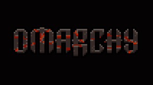
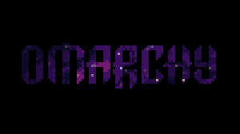
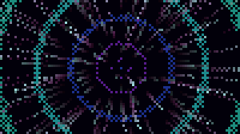
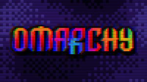

# Pixelsaver for Omarchy

A pixel-art screensaver for [Omarchy](https://omarchy.org). It takes your screensaver branding
(`~/.config/omarchy/branding/screensaver.txt`, set with `omarchy branding screensaver ...`), turns the
block characters into real pixels (each terminal cell is two square truecolor pixels) and animates
them. Eight scenes play in random order, one every 24 seconds:

| | |
|---|---|
|  **EMBERS**: cooled coal lumps rekindle, glow with white-hot cracks and sparks, then settle to ash |  **DAYLIGHT**: a whole day through the letters: dawn, clouds, sun arc, sunset, moon and Milky Way |
|  **DEEP FIELD**: a star ignites inside a letter and lights a nebula across the word |  **SUMI-E**: a brush paints each letter in pale ink, a red seal is pressed, then the ink washes away |
|  **BIOLUME**: glowing sea water, a swell that lights the plankton in its wake |  **MOLTEN**: the letters are windows onto slow lava-lamp blobs |
|  **HYPERSPACE**: particle assembly, chromatic shockwave, lightspeed tunnel |  **SIGNAL CORRUPT**: dithered plasma, datamosh, hex dump, NO SIGNAL card |

It is a small native binary (Rust, no dependencies) that uses about 1% of one CPU core and ~7 MB of RAM
while it runs, and only redraws the terminal cells that change.

## Install

```bash
omarchy plugin add https://github.com/maxberggren/omarchy-pixelsaver.git --enable --yes
omarchy restart shell
```

The restart is needed once, because the built-in idle service stays loaded until the shell restarts.
After that, the next time your machine goes idle pixelsaver starts instead of the stock screensaver.
To see it right away (in a terminal):

```bash
~/.config/omarchy/plugins/maxberggren.pixelsaver/bin/pixelsaver-launch force
```

Any key (or moving focus away) exits, like the built-in screensaver.

**How it hooks in.** Omarchy starts the screensaver from its built-in idle service (`omarchy.idle`).
This plugin is a clone of that service, the same way `omarchy plugin clone` works, with one change:
when the screensaver timeout fires it launches pixelsaver instead of `omarchy-launch-screensaver`.
Idle timeouts, locking, the stay-awake toggle and `omarchy toggle screensaver` all behave as before.
If the bundled binary can't run on your machine (it is built for x86-64), the stock screensaver
is launched instead.

**Uninstall** (brings the built-in idle service back):

```bash
omarchy plugin remove maxberggren.pixelsaver
omarchy restart shell
```

or just `omarchy plugin disable maxberggren.pixelsaver` to switch back temporarily.

## Configure

Optional: put command-line options in `~/.config/omarchy/pixelsaver.conf`, for example

```
--scene embers,daylight,cosmos,ink --duration 40 --fps 24
```

| option | default | |
|---|---|---|
| `--scene a,b,...` | all eight | which scenes to cycle: `embers daylight cosmos ink tide lava warp glitch` |
| `--duration S` | 24 | seconds per scene |
| `--fps N` | 30 | frame rate (lower = even less CPU) |
| `--file ART` | your branding | draw any block-art text file instead |

While it runs: `n` / space / → next scene, `p` / ← previous, `s` saves a PNG to `~/Pictures/pixelsaver/`.

## Run it by hand

```bash
bin/pixelsaver                                   # cycle all scenes in the current terminal
bin/pixelsaver --scene cosmos --duration 60
bin/pixelsaver --shot daylight --at 4,11,21 --size 200x56 --px 3 --out day.png   # PNG frames, no terminal needed
bin/pixelsaver --bench all --size 200x56         # per-frame cost of every scene
bin/pixelsaver --list
```

## Building

`bin/pixelsaver` is committed prebuilt (x86-64-v2, glibc). To rebuild it from source:

```bash
bin/build-native          # cargo build --release in native/, installs bin/pixelsaver
```

`native/` is the Rust source: `src/core.rs` (buffers, blurs, dithering, logo), `src/term.rs` (termios,
diffing half-block encoder), `src/director.rs` (scene cycling and transitions) and one file per scene in
`src/scenes/`.

`pixelsaver.py` is the original Python/numpy implementation the scenes were designed in. It is the
reference the native scenes were ported from and is handy for contact sheets and GIFs
(`./pixelsaver.py --gif warp --seconds 6 --out warp.gif`, `bin/make-gifs`; needs numpy and Pillow).
